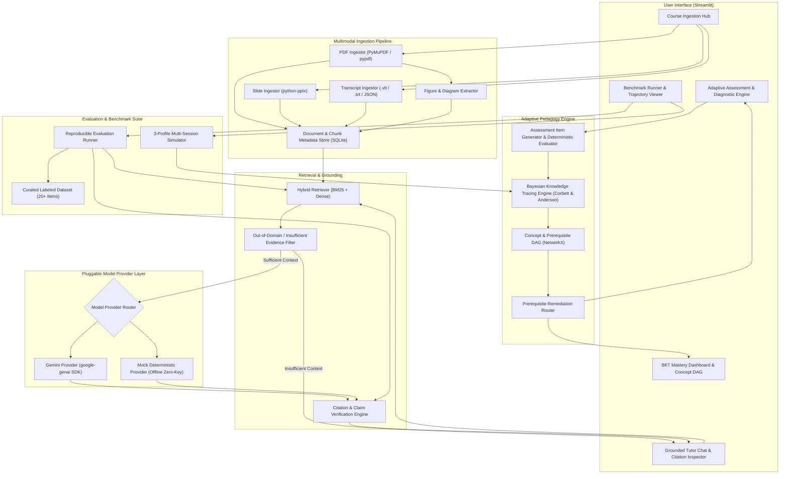

# YOUR TUTOR — SYSTEM ARCHITECTURE
**Multimodal AI Hackathon 2026 — Track D: Personalized Tutoring & Adaptive Learning**

---

## 1. System Context & Overview

**Your Tutor** is structured as a modular, single-process Python application powered by **Streamlit** for the frontend, **SQLite** for relational persistence and learner tracking, an in-process **Hybrid Retrieval Index** (combining lexical BM25 and vector embeddings), a mathematically rigorous **Bayesian Knowledge Tracing (BKT)** engine, and a pluggable **Model Provider** layer supporting both Google Gemini and an offline deterministic engine.



---

## 2. End-to-End Data Flows

### 2.1 File Ingestion to Knowledge Index
1. **User Action**: The student or instructor uploads a course file (`.pdf`, `.pptx`, or `.vtt`/`.srt`/`.json` transcript sidecar).
2. **Parsing & Chunking**:
   - `PDFIngestor`: Extracts text bounded by physical pages. Extracts embedded images to `data/extracted_media/<doc_id>/` and captures page coordinates and captions.
   - `SlideIngestor`: Reads `.pptx` slides, associating slide number, slide title, body shapes, and speaker notes.
   - `TranscriptIngestor`: Reads subtitle segments, recording `start_time` and `end_time` in seconds.
3. **Normalization & Metadata Binding**:
   - Each chunk receives a deterministic `chunk_id` (SHA256 of text + location).
   - Strict metadata is bound: `{document_id, source_type, page_number, slide_number, time_start, time_end, char_start, char_end}`.
4. **Indexing**: Chunks are inserted into SQLite (`content_chunks` table) and token-indexed in the hybrid retriever index.

### 2.2 Grounded Tutoring & Citation Verification
1. **User Query**: Student submits a query (e.g., *"What is the difference between Batch Gradient Descent and Stochastic Gradient Descent?"*).
2. **Hybrid Retrieval**: Top $k=4$ chunks are retrieved using combined lexical (BM25) and semantic vector ranking.
3. **Evidence Sufficiency Check**:
   - If maximum retrieval similarity is below threshold $\theta = 0.35$, the query is classified as **Insufficient Evidence / Out-of-Domain**.
   - The engine halts generation and returns: *"I cannot find sufficient evidence in your course materials to answer this question accurately."*
4. **Synthesis via Model Provider**:
   - The prompt explicitly provides retrieved chunks with bracketed identifiers `[CHUNK_1]`, `[CHUNK_2]`.
   - The prompt enforces strict instruction: *"Every claim must cite its source using `[Source: <filename>, Page/Slide/Time <N>]`. Never cite sources not provided in context."*
5. **Post-Generation Citation Auditing**:
   - The verification engine extracts all `[Source: ...]` citations.
   - Checks that every citation maps to an actual chunk in the retrieved context.
   - Audits whether cited claims have textual support in the chunk. If an unverified claim is detected, an alert badge is appended to the message.

### 2.3 Adaptive Assessment & BKT Mastery Progression
1. **Item Selection / Generation**:
   - The tutor selects a concept from the curriculum based on the student's current mastery state (prioritizing concepts where $P(L) < 0.70$ or untested prerequisites).
   - Retrieves course chunks tagged with that concept.
   - Generates or retrieves an assessment item (MCQ or Short Answer) with an answer key and distractor rationales anchored to course chunks.
2. **Student Submission & Deterministic Grading**:
   - Student selects an option (MCQ) or types an answer.
   - Evaluated deterministically: MCQ matches option key; Short Answer matches regex/normalized keywords with fallback rubric.
3. **BKT State Update**:
   - Retrieves prior $P(L_{t-1})$, $P(T)$, $P(G)$, $P(S)$ for the concept from SQLite.
   - Computes posterior $P(L_t \mid obs)$ and next prior $P(L_{t+1})$ using Corbett & Anderson closed-form equations.
   - Writes update to SQLite (`learner_responses` and `concept_mastery` tables).
4. **Prerequisite Remediation Routing**:
   - If posterior $P(L) < 0.50$, the system queries the `prerequisite_edges` table.
   - Identifies whether any prerequisite ancestor concept has $P(L) < 0.60$.
   - If found, alerts the student: *"Your difficulty with 'Backpropagation' may stem from 'The Chain Rule'. Review Slide 14 of Lecture 3 before continuing."*

---

## 3. Runtime Model-Provider Architecture & Offline Fallback

To prevent external dependency failure during judging and local execution, the architecture strictly decouples LLM generation behind an abstract interface:

```
                  +---------------------------+
                  |    BaseModelProvider      |
                  +---------------------------+
                  | + generate_response(...)  |
                  | + generate_assessment(...) |
                  | + verify_claim(...)       |
                  +-------------+-------------+
                                |
               +----------------+---------------+
               |                                |
+------------------------------+ +------------------------------+
|        GeminiProvider        | |   MockDeterministicProvider  |
+------------------------------+ +------------------------------+
| - Uses `google.genai` SDK    | | - 100% Offline / Zero API Key|
| - Requires GEMINI_API_KEY    | | - Deterministic template-    |
| - High-temperature reasoning | |   grounded response generator|
| - Live multimodality         | | - Perfect for tests & CI/CD  |
| - Rate-limit aware backoff   | | - Explicit badge: [OFFLINE]  |
+------------------------------+ +------------------------------+
```

### 3.1 Behavior of `MockDeterministicProvider`
- **When Active**: Automatically activated if `GEMINI_API_KEY` is not detected in `.env` or user environment, or if explicitly toggled in the Streamlit settings sidebar.
- **Capabilities**:
  1. *Grounded Q&A*: Uses the top retrieved chunk's exact content to synthesize answers using structured templating, preserving exact page citations.
  2. *Refusal*: Perfectly mimics refusal on out-of-domain queries by checking lexical overlap thresholds.
  3. *Assessment*: Generates deterministic MCQs from pre-indexed concept chunk banks with exact distractors and explanations.
  4. *Claim Verification*: Performs deterministic substring and n-gram overlap checks between generated claims and source chunks.
- **Explicit Limitations**:
  - Does not synthesize novel creative pedagogical analogies beyond the text in the chunks.
  - Does not process raw image pixels directly; relies on the pre-extracted OCR text and figure captions.
  - Displays a transparent indicator badge: `[Provider: Offline Deterministic Engine — No API Key Required]`.

---

## 4. Source Metadata & Citation Provenance Flow

The integrity of citations is guaranteed by preserving a strict provenance tuple through every stage of processing:

```
[Physical File: lecture_slides.pptx]
      │
      ▼ (Slide Parser)
[Slide #14 | Title: "Gradient Descent Variants" | Text: "..."]
      │
      ▼ (Chunking & SQLite Insert)
[ContentChunk:
   chunk_id: "chk_9a1f..."
   document_id: "doc_slides_01"
   source_type: "pptx"
   page_number: null
   slide_number: 14
   timestamp_start: null
   timestamp_end: null
   text_content: "Batch gradient descent computes gradients over the entire dataset..."
]
      │
      ▼ (Retriever returns top-k)
[RetrievedContext passed to Prompt with tag: [CHUNK_chk_9a1f]]
      │
      ▼ (LLM Generation)
["Batch gradient descent computes gradients using the full dataset [Source: lecture_slides.pptx, Slide 14]..."]
      │
      ▼ (Citation Auditor checks: does "Slide 14" match chk_9a1f metadata? -> PASS)
[Rendered in Streamlit with clickable provenance drawer displaying Slide 14 text & thumbnail]
```

---

## 5. Security Boundaries & Configuration Management

1. **Zero Secret Exposure**:
   - The repository contains `.env.example`, but `.env`, `*.db`, and extracted user media are strictly ignored in `.gitignore`.
   - API keys are never written to disk, database tables, or Streamlit session logs.
2. **File Upload Sanitization**:
   - Uploaded file names are sanitized using standard secure filename routines (stripping `../`, `..\`, null bytes, and shell characters).
   - Permitted file extensions are strictly whitelisted: `.pdf`, `.pptx`, `.vtt`, `.srt`, `.json`, `.png`, `.jpg`.
   - File size is capped at 50 MB per file.
3. **Local Database Isolation**:
   - SQLite database is stored locally in `data/your_tutor.db`.
   - Uses SQLite WAL (Write-Ahead Logging) mode to prevent concurrency locks during Streamlit UI reruns.
