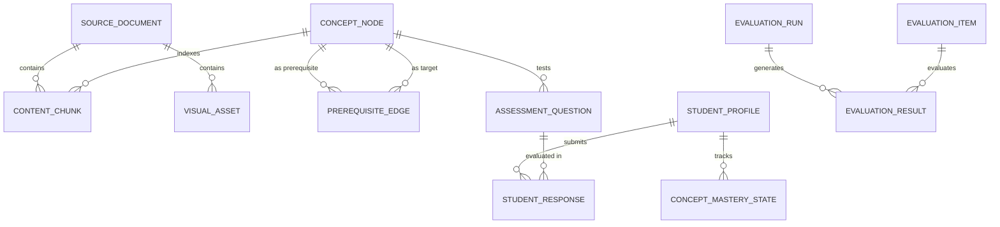

# YOUR TUTOR — DATA MODEL & SCHEMAS
**Multimodal AI Hackathon 2026 — Track D: Personalized Tutoring & Adaptive Learning**

---

## 1. Overview & Data Flow Topology

All domain entities in **Your Tutor** are strictly specified as **Pydantic v2 models** for runtime in-memory validation and mapped directly to a normalized **SQLite** relational schema.



---

## 2. Pydantic Domain Schemas

### 2.1 Ingestion & Multimodal Knowledge Base

```python
from enum import Enum
from typing import List, Optional
from pydantic import BaseModel, Field

class SourceType(str, Enum):
    PDF = "pdf"
    PPTX = "pptx"
    VIDEO_TRANSCRIPT = "video_transcript"
    IMAGE = "image"

class SourceDocument(BaseModel):
    """Represents an ingested course material file."""
    document_id: str = Field(description="Unique SHA256-derived ID of the source document")
    filename: str = Field(description="Original file name e.g., lecture_01_backprop.pdf")
    source_type: SourceType = Field(description="Format of the uploaded file")
    total_pages_or_slides: Optional[int] = Field(default=None, description="Page count for PDF or slide count for PPTX")
    duration_seconds: Optional[float] = Field(default=None, description="Video duration in seconds if video transcript")
    file_size_bytes: int = Field(description="File size in bytes")
    uploaded_at: str = Field(description="ISO 8601 UTC timestamp of ingestion")

class ContentChunk(BaseModel):
    """An atomic text unit with physical source provenance."""
    chunk_id: str = Field(description="Deterministic hash of document_id + location + content")
    document_id: str = Field(description="Foreign key referencing SourceDocument.document_id")
    source_type: SourceType = Field(description="Format type of the source")
    
    # Provenance metadata (at least one must be non-null)
    page_number: Optional[int] = Field(default=None, description="1-indexed physical PDF page number")
    slide_number: Optional[int] = Field(default=None, description="1-indexed presentation slide number")
    slide_title: Optional[str] = Field(default=None, description="Title shape of slide if present")
    is_speaker_notes: bool = Field(default=False, description="True if text originates from PPTX speaker notes")
    time_start_seconds: Optional[float] = Field(default=None, description="Transcript segment start timestamp")
    time_end_seconds: Optional[float] = Field(default=None, description="Transcript segment end timestamp")
    
    # Content & Semantic Indexing
    text_content: str = Field(description="Normalized textual content of the chunk")
    token_count: int = Field(description="Approximate word/token count (typically 150-400 words)")
    associated_concept_ids: List[str] = Field(default_factory=list, description="IDs of concepts covered in this chunk")

class VisualAsset(BaseModel):
    """Extracted figure, diagram, or slide visual element."""
    asset_id: str = Field(description="Unique hash of visual asset")
    document_id: str = Field(description="Foreign key referencing SourceDocument.document_id")
    source_type: SourceType = Field(description="Source format (PDF or PPTX)")
    page_number: Optional[int] = Field(default=None, description="Source page number in PDF")
    slide_number: Optional[int] = Field(default=None, description="Source slide number in PPTX")
    file_path: str = Field(description="Relative local path on disk e.g., data/extracted_media/doc1/fig_p3_1.png")
    caption: Optional[str] = Field(default=None, description="Extracted caption or surrounding text anchor")
    ocr_text: Optional[str] = Field(default=None, description="Text recognized inside diagram")
    semantic_description: str = Field(description="Vision-generated summary of diagram contents")
```

---

### 2.2 Concept & Prerequisite Knowledge Graph

```python
class ConceptNode(BaseModel):
    """A granular learning concept in the course syllabus."""
    concept_id: str = Field(description="Canonical slug e.g., 'backpropagation', 'gradient-descent'")
    name: str = Field(description="Human-readable concept title")
    topic: str = Field(description="High-level syllabus topic e.g., 'Optimization'")
    description: str = Field(description="Core curriculum definition of the concept")
    
    # BKT Default Priors (Literature-backed)
    p_l0_default: float = Field(default=0.20, ge=0.01, le=0.99, description="Default initial mastery prior P(L0)")
    p_t_default: float = Field(default=0.15, ge=0.01, le=0.50, description="Transition probability P(T)")
    p_g_default: float = Field(default=0.20, ge=0.01, le=0.40, description="Guess probability P(G)")
    p_s_default: float = Field(default=0.10, ge=0.01, le=0.30, description="Slip probability P(S)")

class PrerequisiteEdge(BaseModel):
    """Directed edge indicating prerequisite dependency: prerequisite_id -> target_concept_id."""
    prerequisite_id: str = Field(description="ID of concept that must be understood first")
    target_concept_id: str = Field(description="ID of concept that depends on prerequisite")
    weight: float = Field(default=1.0, ge=0.1, le=1.0, description="Dependency strength")
```

---

### 2.3 Learner State & Bayesian Knowledge Tracing (BKT)

```python
class StudentProfile(BaseModel):
    """Represents a student user account / session."""
    student_id: str = Field(description="Unique student identifier (e.g., 'student_default' or test persona ID)")
    name: str = Field(description="Display name")
    created_at: str = Field(description="ISO 8601 UTC creation timestamp")

class ConceptMasteryState(BaseModel):
    """Current BKT mastery state for a specific student and concept."""
    student_id: str = Field(description="Foreign key to StudentProfile.student_id")
    concept_id: str = Field(description="Foreign key to ConceptNode.concept_id")
    p_mastery: float = Field(ge=0.0, le=1.0, description="Current posterior mastery probability P(L_t)")
    total_attempts: int = Field(default=0, ge=0, description="Number of practice attempts on this concept")
    correct_attempts: int = Field(default=0, ge=0, description="Number of correct responses")
    last_updated_at: str = Field(description="ISO 8601 UTC timestamp of last mastery update")

class StudentResponse(BaseModel):
    """Historical log entry for an answered assessment question."""
    response_id: str = Field(description="Unique log ID")
    student_id: str = Field(description="Foreign key to StudentProfile.student_id")
    question_id: str = Field(description="Foreign key to AssessmentQuestion.question_id")
    concept_id: str = Field(description="Foreign key to ConceptNode.concept_id")
    student_answer: str = Field(description="Option key or textual string submitted by student")
    is_correct: bool = Field(description="Deterministic grading outcome (1 or 0)")
    
    # Explainable BKT Audit Trail
    prior_p_mastery: float = Field(description="P(L_{t-1}) before observing response")
    posterior_p_mastery: float = Field(description="P(L_t) computed immediately after observation")
    timestamp: str = Field(description="ISO 8601 UTC timestamp")
```

---

### 2.4 Adaptive Assessment Items

```python
class QuestionType(str, Enum):
    MCQ = "mcq"
    SHORT_ANSWER = "short_answer"
    NUMERICAL = "numerical"

class AssessmentOption(BaseModel):
    """Option choice for a Multiple-Choice Question."""
    option_key: str = Field(description="Option letter e.g., 'A', 'B', 'C', 'D'")
    option_text: str = Field(description="The text of the choice")
    misconception_explanation: Optional[str] = Field(default=None, description="Why this choice is incorrect if distractor")

class AssessmentQuestion(BaseModel):
    """A curriculum-grounded assessment question."""
    question_id: str = Field(description="Unique hash of question stem + concept")
    concept_id: str = Field(description="Foreign key to ConceptNode.concept_id")
    question_type: QuestionType = Field(description="Format of the question")
    difficulty: str = Field(default="intermediate", description="'novice', 'intermediate', or 'advanced'")
    question_stem: str = Field(description="The question prompt")
    
    # Options (MCQ only)
    options: List[AssessmentOption] = Field(default_factory=list, description="List of choices for MCQ")
    correct_answer: str = Field(description="Correct option key e.g., 'B' or normalized short-answer string")
    numerical_tolerance: Optional[float] = Field(default=None, description="Tolerance if question_type == numerical")
    
    # Provenance & Feedback
    source_chunk_ids: List[str] = Field(description="Chunks supporting this question's answer and explanation")
    citation_display: str = Field(description="Human-readable citation e.g., '[Source: textbook.pdf, Page 45]'")
    explanation: str = Field(description="Complete step-by-step reasoning citing course evidence")
    is_seed_verified: bool = Field(default=True, description="True if human/curriculum-verified; False if live LLM generated")
```

---

### 2.5 Evaluation Benchmark Schemas

```python
class EvaluationCategory(str, Enum):
    IN_DOMAIN = "in_domain"
    OUT_OF_DOMAIN = "out_of_domain"
    DIAGRAM_GROUNDED = "diagram_grounded"

class EvaluationItem(BaseModel):
    """A single benchmark test case."""
    item_id: str = Field(description="Unique test ID e.g., 'EVAL_IND_01'")
    category: EvaluationCategory = Field(description="Category of evaluation item")
    question: str = Field(description="User query to present to tutor")
    expected_should_refuse: bool = Field(description="True if question is out-of-domain and must be refused")
    ground_truth_answer: Optional[str] = Field(default=None, description="Expected ideal answer if in-domain")
    target_chunk_ids: List[str] = Field(default_factory=list, description="Chunk IDs containing necessary evidence")
    expected_citations: List[str] = Field(default_factory=list, description="Expected citation strings e.g., ['Slide 14']")

class EvaluationResult(BaseModel):
    """Output metrics for a single evaluated benchmark item."""
    item_id: str = Field(description="Foreign key to EvaluationItem.item_id")
    category: EvaluationCategory
    generated_response: str
    retrieved_chunk_ids: List[str]
    is_refused: bool
    refusal_correct: bool
    citation_precision: float
    citation_recall: float
    claim_faithfulness: float
```

---

## 3. SQLite Relational DDL Mapping

The SQLite database (`data/your_tutor.db`) enforces relational foreign keys and indexes for sub-second queries:

```sql
-- 1. Source Documents
CREATE TABLE IF NOT EXISTS source_documents (
    document_id TEXT PRIMARY KEY,
    filename TEXT NOT NULL,
    source_type TEXT NOT NULL,
    total_pages_or_slides INTEGER,
    duration_seconds REAL,
    file_size_bytes INTEGER NOT NULL,
    uploaded_at TEXT NOT NULL
);

-- 2. Content Chunks (with physical provenance)
CREATE TABLE IF NOT EXISTS content_chunks (
    chunk_id TEXT PRIMARY KEY,
    document_id TEXT NOT NULL REFERENCES source_documents(document_id) ON DELETE CASCADE,
    source_type TEXT NOT NULL,
    page_number INTEGER,
    slide_number INTEGER,
    slide_title TEXT,
    is_speaker_notes INTEGER DEFAULT 0,
    time_start_seconds REAL,
    time_end_seconds REAL,
    text_content TEXT NOT NULL,
    token_count INTEGER NOT NULL
);

CREATE INDEX IF NOT EXISTS idx_chunks_doc ON content_chunks(document_id);
CREATE INDEX IF NOT EXISTS idx_chunks_page ON content_chunks(page_number);
CREATE INDEX IF NOT EXISTS idx_chunks_slide ON content_chunks(slide_number);

-- 3. Visual Assets
CREATE TABLE IF NOT EXISTS visual_assets (
    asset_id TEXT PRIMARY KEY,
    document_id TEXT NOT NULL REFERENCES source_documents(document_id) ON DELETE CASCADE,
    source_type TEXT NOT NULL,
    page_number INTEGER,
    slide_number INTEGER,
    file_path TEXT NOT NULL,
    caption TEXT,
    ocr_text TEXT,
    semantic_description TEXT NOT NULL
);

-- 4. Concept Nodes & Prerequisite DAG
CREATE TABLE IF NOT EXISTS concept_nodes (
    concept_id TEXT PRIMARY KEY,
    name TEXT NOT NULL,
    topic TEXT NOT NULL,
    description TEXT NOT NULL,
    p_l0_default REAL NOT NULL DEFAULT 0.20,
    p_t_default REAL NOT NULL DEFAULT 0.15,
    p_g_default REAL NOT NULL DEFAULT 0.20,
    p_s_default REAL NOT NULL DEFAULT 0.10
);

CREATE TABLE IF NOT EXISTS prerequisite_edges (
    prerequisite_id TEXT NOT NULL REFERENCES concept_nodes(concept_id) ON DELETE CASCADE,
    target_concept_id TEXT NOT NULL REFERENCES concept_nodes(concept_id) ON DELETE CASCADE,
    weight REAL DEFAULT 1.0,
    PRIMARY KEY (prerequisite_id, target_concept_id)
);

-- 5. Student Profiles & BKT Mastery State
CREATE TABLE IF NOT EXISTS student_profiles (
    student_id TEXT PRIMARY KEY,
    name TEXT NOT NULL,
    created_at TEXT NOT NULL
);

CREATE TABLE IF NOT EXISTS concept_mastery_state (
    student_id TEXT NOT NULL REFERENCES student_profiles(student_id) ON DELETE CASCADE,
    concept_id TEXT NOT NULL REFERENCES concept_nodes(concept_id) ON DELETE CASCADE,
    p_mastery REAL NOT NULL,
    total_attempts INTEGER DEFAULT 0,
    correct_attempts INTEGER DEFAULT 0,
    last_updated_at TEXT NOT NULL,
    PRIMARY KEY (student_id, concept_id)
);

-- 6. Student Responses (Audit Log)
CREATE TABLE IF NOT EXISTS student_responses (
    response_id TEXT PRIMARY KEY,
    student_id TEXT NOT NULL REFERENCES student_profiles(student_id) ON DELETE CASCADE,
    question_id TEXT NOT NULL,
    concept_id TEXT NOT NULL REFERENCES concept_nodes(concept_id) ON DELETE CASCADE,
    student_answer TEXT NOT NULL,
    is_correct INTEGER NOT NULL,
    prior_p_mastery REAL NOT NULL,
    posterior_p_mastery REAL NOT NULL,
    timestamp TEXT NOT NULL
);

CREATE INDEX IF NOT EXISTS idx_responses_student ON student_responses(student_id);
CREATE INDEX IF NOT EXISTS idx_responses_concept ON student_responses(concept_id);
```

---

## 4. Integrity Constraints & Validation Rules

1. **Uniqueness Constraints**:
   - `content_chunks.chunk_id` is a cryptographic SHA256 hash of `document_id + coalesce(page_number, slide_number, time_start) + text_content`.
   - `prerequisite_edges` enforces `(prerequisite_id, target_concept_id)` uniqueness and forbids self-loops (`prerequisite_id != target_concept_id`).
2. **Provenance Mandatory Fields**:
   - Every `ContentChunk` must have at least one non-null provenance anchor: either `page_number`, `slide_number`, or `time_start_seconds`. A chunk lacking all three fails validation immediately.
3. **BKT Parameter Constraints**:
   - All $P(L_0), P(T), P(G), P(S) \in (0.0, 1.0)$ with degeneracy check: $P(G) + P(S) < 0.95$.
   - Posterior $P(L_t)$ is clamped to $[\epsilon, 1 - \epsilon]$ where $\epsilon = 10^{-4}$ to prevent floating-point underflow or division-by-zero.
