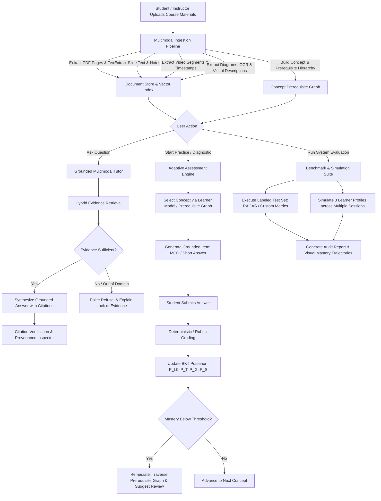

# YOUR TUTOR — SYSTEM REQUIREMENTS SPECIFICATION (SRS)
**Multimodal AI Hackathon 2026 — Track D: Personalized Tutoring & Adaptive Learning**

---

## 1. Introduction & Overview

This document specifies the functional and non-functional requirements for **Your Tutor**. Every requirement is uniquely indexed, assigned an implementation status (Full, Partial, Deferred), and accompanied by explicit, testable acceptance criteria mapped directly to the Hackathon judging rubric.

---

## 2. Core User Workflow

---

## 3. Functional Requirements (FR)

### Category A: Multimodal Knowledge Base & Ingestion (Rubric: 20%)

| ID | Requirement Title | Scope | Description | Testable Acceptance Criteria |
| :--- | :--- | :---: | :--- | :--- |
| **FR-101** | PDF Textbook Ingestion & Page Indexing | **Full** | Extract text, headings, and page boundaries from standard PDF documents using PyMuPDF (`fitz`) or `pypdf`. | 1. 100% of extracted text chunks must retain `source_file` and `page_number` in metadata. 2. Chunks must preserve chapter/section headings where present. 3. Extracted chunk length must be bounded (e.g., 250–600 tokens) with 50-token overlap. |
| **FR-102** | Slide Deck Ingestion (PPTX) | **Full** | Ingest PowerPoint presentations (`.pptx`) using `python-pptx`, extracting slide text, slide numbers, titles, and speaker notes. | 1. Every extracted chunk must store `slide_number` and `slide_title`. 2. Speaker notes must be indexed alongside slide text but flagged with `is_notes: true`. |
| **FR-103** | Video Lecture Ingestion & Timestamp Indexing | **Partial** | Ingest lecture video metadata and transcript segments with millisecond/second-level timestamps (`start_time`, `end_time`). | 1. Video files accompanied by `.vtt`, `.srt`, or pre-computed JSON transcripts must be indexed down to precise second ranges `[MM:SS - MM:SS]`. 2. Citation output must format video links as `[Source: video_name, 04:15 - 04:45]`. 3. *Constraint*: Direct raw video audio extraction requires ffmpeg; if system ffmpeg is absent, the system gracefully ingests paired transcript sidecars or API-transcribed streams. |
| **FR-104** | Figure, Diagram & Image Extraction | **Full** | Identify embedded figures/diagrams in PDFs and slides, extract them to disk, extract text using OCR/Vision, and generate semantic captions. | 1. Extracted images are saved under `data/extracted_media/<doc_id>/`. 2. Bounding boxes or page numbers must link the image back to its source page. 3. A semantic textual description (e.g., "Architecture diagram illustrating Transformer Encoder-Decoder layers") must be generated and indexed for retrieval. |
| **FR-105** | Concept & Prerequisite Knowledge Organization | **Full** | Maintain a structured topic, subtopic, concept, and prerequisite DAG representing the curriculum structure. | 1. Represented as a directed graph where nodes are concepts and directed edges indicate `(Prerequisite) -> (Target Concept)`. 2. Validated to be a Directed Acyclic Graph (DAG) with zero cycles. 3. Chunks must be associated with one or more concept nodes. |
| **FR-106** | Cross-Format Concept Alignment | **Partial** | Link related concepts extracted across different modalities (e.g., connecting Textbook Page 42 with Lecture Slide 12 and Video Timestamp 08:30). | 1. A unified search for a concept query must return ranked candidate chunks spanning multiple media types. 2. Provenance inspector displays all modalities covering that concept. |

---

### Category B: Source Grounding & Retrieval Verification (Rubric: 20%)

| ID | Requirement Title | Scope | Description | Testable Acceptance Criteria |
| :--- | :--- | :---: | :--- | :--- |
| **FR-201** | Multimodal Hybrid Retrieval | **Full** | Retrieve top-$k$ relevant chunks using a hybrid scoring mechanism (dense embedding similarity + lexical keyword matching / BM25). | 1. Given a user query, return top $k \in [3, 5]$ chunks with similarity scores. 2. Chunks include text excerpts, figure captions, and video transcripts. |
| **FR-202** | Source-Grounded Generation & Explicit Citations | **Full** | Generate instructional responses strictly constrained to retrieved context, with mandatory inline citations. | 1. All factual claims must be followed by `[Source: <filename>, Page/Slide/Time <N>]`. 2. If the user asks for a diagram, the tutor includes the image path and describes its visual content. |
| **FR-203** | Automated Claim Verification Layer | **Full** | An automated verification step evaluates the generated response against the retrieved source chunks before presenting the response. | 1. The verification layer checks whether every cited claim has textual overlap/semantic entailment in the corresponding retrieved chunk. 2. If a hallucinated or uncited claim is detected, the response is flagged or filtered. 3. *Constraint*: Documented explicitly that automated verification is probabilistic and not an infallible ground-truth oracle. |
| **FR-204** | Out-of-Domain & Insufficient Evidence Refusal | **Full** | Detect when a question cannot be answered using the ingested course materials and politely refuse rather than hallucinating. | 1. For questions with top retrieval similarity below threshold $\theta$ or tagged out-of-domain, the tutor responds: *"I cannot find sufficient evidence in your course materials to answer this question accurately."* 2. Refusal rate on out-of-domain benchmark items must exceed 90%. |
| **FR-205** | Distinction Between Course Evidence & World Knowledge | **Full** | Explicitly distinguish between course-mandated terminology and outside conventions. | 1. When explaining concepts where notation differs across textbooks, the tutor explicitly highlights: *"According to your course materials [Source: X], this term is defined as..."* |

---

### Category C: Adaptive Assessments (Rubric: 15%)

| ID | Requirement Title | Scope | Description | Testable Acceptance Criteria |
| :--- | :--- | :---: | :--- | :--- |
| **FR-301** | Multi-Format Question Generation | **Full** | Generate Multiple-Choice Questions (MCQ) and Short-Answer questions tied to specific course concepts and difficulty tiers (Novice, Intermediate, Advanced). | 1. Every generated question has: `question_id`, `concept_id`, `difficulty`, `question_stem`, `options` (for MCQ), `correct_answer`, `explanation`, and `source_chunk_ids`. 2. Distractors must represent plausible student misconceptions rather than nonsensical options. |
| **FR-302** | Deterministic Answer Evaluation | **Full** | Evaluate student answers deterministically for MCQs and structured short answers. | 1. MCQ evaluation must be 100% deterministic (letter/index matching). 2. Short answers evaluated using fuzzy keyword/regex rules with LLM-fallback only for semantic paraphrasing. 3. Numerical questions evaluated with an explicit float tolerance (e.g., $\pm 2\%$). |
| **FR-303** | Question History & Duplicate Prevention | **Full** | Track previously administered questions to prevent repetition during the same study session or diagnostic sequence. | 1. System records all served `question_id`s in the session state/SQLite database. 2. In a sequence of 15 practice questions, question duplicate rate must be exactly 0%. |
| **FR-304** | Misconception Analysis & Cited Feedback | **Full** | Provide immediate explanatory feedback upon answer submission, citing the exact course page/slide explaining the correct reasoning. | 1. Feedback must cite the exact page/slide justifying why the correct answer is right and why the chosen distractor is mistaken. 2. Formats feedback with constructive pedagogical hints. |
| **FR-305** | Question Provenance & Verification Tagging | **Full** | Explicitly distinguish between pre-verified seed questions and live LLM-generated questions. | 1. Questions must display a provenance tag: `[Verified Curriculum Item]` or `[Live Grounded Item]`. 2. Answer keys of live items must pass automated sanity checks before display. |

---

### Category D: Learner Model (Bayesian Knowledge Tracing) (Rubric: 20%)

| ID | Requirement Title | Scope | Description | Testable Acceptance Criteria |
| :--- | :--- | :---: | :--- | :--- |
| **FR-401** | Standard BKT Parameterization | **Full** | Maintain genuine Corbett & Anderson (1994) BKT parameters for each concept in the knowledge graph: $P(L_0)$ (initial mastery), $P(T)$ (transition probability), $P(G)$ (guess probability), $P(S)$ (slip probability). | 1. Parameters are stored per concept node with default bounds: $P(L_0) \in [0.1, 0.3]$, $P(T) \in [0.1, 0.3]$, $P(G) \in [0.1, 0.3]$, $P(S) \in [0.05, 0.2]$. 2. Degenerate parameter regions ($P(G) + P(S) \ge 1.0$) are prevented by assertion validation. |
| **FR-402** | Closed-Form Posterior Mastery Updating | **Full** | Compute exact analytical BKT posterior mastery probabilities after every student response. | 1. If response is correct ($obs = 1$): $$P(L_t \mid obs=1) = \frac{P(L_{t-1}) \cdot (1 - P(S))}{P(L_{t-1}) \cdot (1 - P(S)) + (1 - P(L_{t-1})) \cdot P(G)}$$ 2. If response is incorrect ($obs = 0$): $$P(L_t \mid obs=0) = \frac{P(L_{t-1}) \cdot P(S)}{P(L_{t-1}) \cdot P(S) + (1 - P(L_{t-1})) \cdot (1 - P(G))}$$ 3. Apply learning transition to next step: $$P(L_{t+1}) = P(L_t \mid obs) + (1 - P(L_t \mid obs)) \cdot P(T)$$ 4. Math unit tests pass with zero floating-point divergence. |
| **FR-403** | Diagnostic Onboarding Sequence | **Full** | Administer a 3–5 question diagnostic quiz to new students to establish initial empirical mastery baselines. | 1. Tests fundamental root concepts in the prerequisite graph. 2. Updates initial $P(L)$ values before adaptive practice begins. |
| **FR-404** | Prerequisite-Aware Remediation Routing | **Full** | When a student's posterior mastery on a concept falls below threshold $\tau = 0.50$, query the prerequisite graph to identify unmastered ancestors and route remediation. | 1. If concept $C_k$ is failing, evaluate $P(L)$ of all direct prerequisites $\{C_p\}$. 2. If any prerequisite has $P(L) < 0.60$, recommend reviewing $C_p$ first, displaying its exact slides and textbook pages. |
| **FR-405** | Persistent Learner State & Audit Log | **Full** | Store learner interaction logs, timestamped answers, and mastery trajectories in SQLite. | 1. Each response log contains: `timestamp`, `user_id`, `concept_id`, `question_id`, `is_correct`, `prior_p_L`, `posterior_p_L`. 2. State persists across application restarts. |

---

### Category E: System Evaluation & Benchmarking (Rubric: 15%)

| ID | Requirement Title | Scope | Description | Testable Acceptance Criteria |
| :--- | :--- | :---: | :--- | :--- |
| **FR-501** | Curated Labeled Evaluation Benchmark | **Full** | Implement a standardized, version-controlled evaluation dataset (`eval/benchmark_dataset.json`) containing at least 20 labeled test cases across three categories. | 1. Category 1: In-domain questions with known target chunks and ground truth answers. 2. Category 2: Unsupported / Out-of-syllabus questions with expected refusal. 3. Category 3: Visual/Diagram questions requiring interpretation of embedded figures. |
| **FR-502** | Automated Grounding & Retrieval Metrics | **Full** | Compute reproducible metrics: Context Precision, Context Recall, Faithfulness (unsupported claim rate), and Citation Correctness. | 1. Automated runner executes all test items without manual intervention. 2. Generates a structured JSON/Markdown report with per-question and aggregate scores. |
| **FR-503** | Assessment Quality & Deduplication Metrics | **Full** | Benchmark question generator for answer-key correctness and duplicate frequency. | 1. Answer-key validation rate measured against ground truth. 2. Repetition rate measured over 20 consecutive generated questions. |
| **FR-504** | Multi-Session Simulated Learner Benchmarks | **Full** | Simulate at least 3 distinct learner archetypes over multi-step learning trajectories: (1) Struggling/High-Slip Learner, (2) Guessing/Inconsistent Learner, (3) Fast Learner. | 1. Run 15-trial simulations per profile. 2. Export and plot mastery trajectories $P(L)$ over time. 3. Prove that BKT trajectories accurately reflect simulated behavioral parameters. |

---

### Category F: User Interface & Experience (Rubric: 15%)

| ID | Requirement Title | Scope | Description | Testable Acceptance Criteria |
| :--- | :--- | :---: | :--- | :--- |
| **FR-601** | Streamlit Course Material Ingestion Hub | **Full** | Interactive file upload UI for PDFs, PPTX decks, and video transcript sidecars with ingestion progress indicators. | 1. Drag-and-drop file upload with format validation. 2. Displays summary of ingested documents: total pages, slides, video minutes, extracted figures, and indexed chunks. |
| **FR-602** | Grounded Tutor Chat with Provenance Drawer | **Full** | Clean chat interface for asking course questions, featuring collapsible citation drawers displaying source snippets and images. | 1. Inline citation badges e.g., `[Slide 14]` or `[Page 22]`. 2. Clicking or expanding citation displays the exact text snippet and figure thumbnail. |
| **FR-603** | Adaptive Assessment & Quiz Interface | **Full** | Interactive quiz module presenting one question at a time, providing instant deterministic grading, BKT mastery shift visualization, and cited feedback. | 1. Instant feedback on submit. 2. Shows visual indicator of mastery delta (e.g., $P(L): 0.35 \rightarrow 0.62$). |
| **FR-604** | Concept Mastery Dashboard & Prerequisite Map | **Full** | Visual dashboard displaying topic-level mastery heatmaps and interactive prerequisite graph. | 1. Visual rendering of the concept DAG with nodes color-coded by mastery ($P(L) < 0.5$ Red, $0.5 \le P(L) < 0.8$ Yellow, $P(L) \ge 0.8$ Green). 2. Clicking a weak node presents a "Review Prerequisites" recommendation. |
| **FR-605** | Evaluation & Benchmark Results Dashboard | **Full** | An in-app viewer for running and inspecting the evaluation benchmark and simulated learner trajectories. | 1. Single-click benchmark runner. 2. Displays table of metrics and plots of simulated student trajectories. |

---

## 4. Non-Functional Requirements (NFR)

| ID | Category | Description | Acceptance Criteria |
| :--- | :--- | :--- | :--- |
| **NFR-001** | **Performance & Latency** | Local chunk retrieval and BKT posterior update must be near instantaneous. | 1. Retrieval of top-5 chunks from SQLite/in-memory vector index completes in $< 350\text{ ms}$. 2. BKT mathematical update completes in $< 5\text{ ms}$. 3. Streamlit UI re-renders in $< 1.5\text{ s}$. |
| **NFR-002** | **Security & Privacy** | Protect user data, prevent key leakage, and safely handle uploads. | 1. Zero hardcoded secrets, tokens, or API keys in code or git. 2. API keys read strictly from `.env` or Streamlit secrets. 3. Uploaded files restricted to `.pdf`, `.pptx`, `.vtt`, `.srt`, `.json`, `.png`, `.jpg`. Uploads strictly sanitized to prevent path traversal attacks. |
| **NFR-003** | **Reliability & Fallback** | The application must function reliably even if external LLM APIs fail, rate-limit, or lack keys. | 1. Pluggable `ModelProvider` architecture. 2. High-fidelity `MockDeterministicProvider` ships with the app, returning deterministic grounded responses, allowing 100% of tests, UI workflows, and benchmarks to run offline. |
| **NFR-004** | **Reproducibility** | All evaluation benchmarks, random question selections, and learner simulations must be reproducible. | 1. Fixed random seeds used across evaluation and simulation modules. 2. Running `python eval/run_benchmarks.py` produces bit-for-bit identical metric outputs given the same seed. |
| **NFR-005** | **Portability & Maintainability**| Modular Python code conforming to PEP 8 with zero complex binary dependencies. | 1. Runs cleanly on standard Windows 11 and Linux without requiring C++ compilation tools or external Docker engines. 2. Modularity enforced: `ingestion/`, `retrieval/`, `bkt/`, `assessment/`, `grounding/`, `evaluation/`, `ui/`. |

---

## 5. Scope Matrix: Full vs. Partial vs. Deferred

| Functional Area | Full Implementation | Partial Implementation | Deferred to Post-Hackathon |
| :--- | :--- | :--- | :--- |
| **Multimodal Ingestion** | PDF pages & PPTX slides, extracted diagram images, structured text chunks, page/slide metadata. | Video transcription: Uses companion `.vtt`/`.srt` transcripts or API speech recognition; raw direct audio extraction is skipped if system ffmpeg is absent. | Continuous real-time video streaming OCR; 3D model rendering. |
| **Grounding & Retrieval** | Hybrid lexical + semantic ranking, page/slide citations, automated claim-chunk verification, out-of-domain refusal. | Visual grounding: Textual captions + OCR bounding boxes associated with pages. | Pixel-level bounding box heatmaps overlaid directly on video player frames. |
| **Adaptive Learning** | Full 4-parameter Corbett & Anderson BKT model, posterior updates, DAG prerequisite graph, diagnostic quiz. | Parameter estimation: Uses literature-backed heuristic defaults per concept rather than EM/Baum-Welch fitting across 10,000 students. | Multi-skill item response theory (MIRT) and Deep Knowledge Tracing (DKT). |
| **Assessments** | Grounded MCQs and short answers, deterministic grading, duplicate tracking, cited misconception feedback. | Numerical checking: Bounded tolerance regex matching. | Open-ended essay grading with automated rubric calibration. |
| **Evaluation** | 20+ question curated benchmark, precision, recall, faithfulness, 3 simulated learner trajectories across 15 sessions. | RAGAS integration: Lightweight custom metric runner with RAGAS-compatible formulas. | Human-in-the-loop double-blind pedagogical effectiveness study. |
| **Architecture** | Streamlit + SQLite + Pydantic + Pluggable ModelProvider (Gemini + Offline Mock). | Local file storage for extracted assets. | Distributed microservices, Celery queues, PostgreSQL, Qdrant cluster. |
